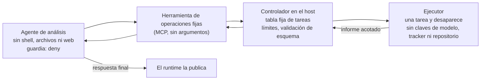

# Ejecutor de tareas fijas: `deny` estricto para agentes que deben leer texto externo

> 🌐 [English](fixed-job-runner.md) · [Русский](fixed-job-runner.ru.md) · **Español** · [Français](fixed-job-runner.fr.md) · [中文](fixed-job-runner.zh.md)

## El problema

En `"mode": "deny"` no se pregunta a nadie: cuando una sesión ha leído texto externo, la [guardia de flujo](flow-guard.es.md)
rechaza código de shell opaco (`npm run …`, `node -e …`, una CLI de tracker que publica un comentario). Ese es el
sentido del modo. Pero algunos agentes leen texto externo en su primer paso y después tienen que ejecutar cosas:

- un agente de QA lee su tarea en un tracker, ejecuta pruebas de navegador y lee sus informes (texto de páginas);
- un agente de resúmenes lee incidencias y después informa mediante un script;
- un agente de soporte lee el mensaje de un cliente y después consulta un sistema.

Ese agente en `deny` se detiene en su primera orden. Bajar `deny` a `ask` sin persona, o etiquetar `npm run` como
solo lectura, quita la protección que debía dar. El ejecutor de tareas fijas mantiene `deny` y aleja del agente el
trabajo que no puede hacer con seguridad.

## El esquema

| Parte | Recibe | No debe recibir |
|---|---|---|
| Agente de análisis | solo las herramientas de operaciones fijas; el texto de su tarea | shell, leer/escribir archivos, descargar páginas, subagentes, otros servidores MCP |
| Herramienta | una petición por operación a una dirección fija del controlador | ningún argumento del modelo (ni URL, ni orden, ni ruta, ni flag) |
| Controlador | la tabla de tareas, la orden que lanza el ejecutor, límites de frecuencia y concurrencia | nada de la petición salvo el nombre de la operación |
| Ejecutor | el código de la tarea y las pocas credenciales que necesita la propia tarea (una cuenta de prueba) | la clave del modelo, el token del tracker, claves del repositorio, el socket de Docker, archivos del host |

Reglas que lo sostienen:

1. **El agente elige, nunca compone.** Las herramientas no tienen argumentos; cada una corresponde a una fila de la
   tabla del controlador. Un nombre desconocido o cualquier argumento se rechaza antes de empezar nada.
2. **El ejecutor es desechable y pobre.** Un contenedor nuevo por tarea: raíz de solo lectura, escritura solo en
   volúmenes temporales, todas las capabilities eliminadas, límites de memoria/CPU/procesos, sin secretos ajenos.
3. **El informe son datos con esquema.** El controlador acepta solo una forma exacta (contadores, nombres de tu propio
   código, primeras líneas de error sin cadenas entre comillas ni rutas de URL). Lo demás se convierte en error, nunca
   «tal cual». Una ejecución que no ejecutó nada es un fallo, no un éxito.
4. **Los límites viven en el controlador,** no en la herramienta: una tarea a la vez, intervalos mínimos para tareas
   que tocan producción, una cuota de arranques por ventana que sobrevive a un reinicio.
5. **Los efectos laterales, a otro agente.** Abrir bugs, publicar informes o cambiar registros requiere una
   herramienta que escribe. Dásela a un segundo agente que no lea el texto externo que procesó el primero, o que
   trabaje sin más claves que la que usa para escribir y detrás de una lista de salida permitida. La respuesta final
   del agente de análisis la publica el runtime.
6. **La red sigue importando.** El ejecutor llega a los sistemas bajo prueba; ponlo detrás de una lista de salida
   permitida. La guardia ve llamadas a herramientas, no la red.

## Dónde encaja WARDEN

- En el agente de análisis: `"mode": "deny"`. No tiene nada que filtrar ni con qué, y la guardia lo mantiene así si
  el conjunto de herramientas crece.
- En lugar de una herramienta propia, el [TaskAdapter](flow-guard.es.md) de WARDEN (`warden-mcp task`) puede ser la
  herramienta de operaciones fijas: un manifiesto fijado de operaciones HTTP, un presupuesto de usos y una caducidad,
  aplicados por WARDEN. Para una tarea de minutos, da a la operación `timeoutSeconds` (hasta 3600) y añade una operación de solo lectura «último resultado»; con un progress token del cliente, el adaptador informa del progreso mientras espera.
- En el agente de efectos laterales: `audit` (debe escribir tras leer el informe) más claves mínimas y la lista de
  salida permitida; lee el registro con `scripts/flow-log-stats.mjs`.
- Marca las fuentes que lee tu integración en `untrustedSources` (para Multica:
  `examples/policies/multica.flow-policy.json`).

## Comprobaciones de aceptación

1. **Los flags de arranque del runtime no deshacen las restricciones.** Arranca el agente exactamente como lo hace tu
   runtime (para Claude Code bajo Multica: `--dangerously-skip-permissions --strict-mcp-config --mcp-config …`) y lee
   la lista de herramientas que recibió: solo pueden aparecer las de operaciones fijas. En Claude Code, las
   herramientas de `permissions.deny` se quitan de esa lista incluso en modo bypass.
2. El controlador rechaza tareas desconocidas, cualquier cuerpo o cadena de consulta, otros pares, una segunda tarea
   concurrente y una tarea de producción dentro de su intervalo mínimo.
3. El contenedor del ejecutor tiene raíz de solo lectura, sin capabilities, sin socket de Docker y solo los nombres de
   variables de entorno esperados.
4. Una tarea fallida y una tarea vacía vuelven ambas como fallo. Un informe fuera de esquema se convierte en error.
5. Una prompt injection escenificada en el texto externo que lee el agente (tarea, informe) no le hace llamar nada
   salvo sus herramientas fijas.

## Límites

- El informe sigue siendo texto externo: nombres y líneas de error pueden venir del sistema bajo prueba. Mantenlo
  breve y depurado, y trátalo como datos.
- La respuesta final del agente se publica sin llamada a herramienta. Lo que puede llevar está acotado por lo que
  llevaba el informe.
- El punto débil es el agente de efectos laterales: déjale solo la clave con la que escribe.
- Esto reduce lo que puede hacer un agente con prompt injection; no hace inofensivas las propias tareas. Revisa cada
  tarea.
