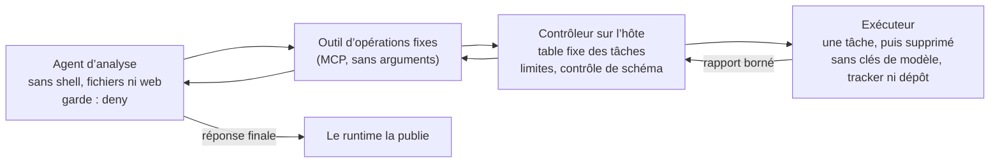

# Exécuteur de tâches fixes : `deny` strict pour des agents qui doivent lire du texte extérieur

> 🌐 [English](fixed-job-runner.md) · [Русский](fixed-job-runner.ru.md) · [Español](fixed-job-runner.es.md) · **Français** · [中文](fixed-job-runner.zh.md)

## Le problème

En `"mode": "deny"`, personne n’est interrogé : une fois qu’une session a lu du texte extérieur, la
[garde de flux](flow-guard.fr.md) refuse le code shell opaque (`npm run …`, `node -e …`, une CLI de tracker qui
publie un commentaire). C’est le but du mode. Mais certains agents lisent du texte extérieur dès leur première étape
et doivent ensuite lancer des choses :

- un agent QA lit sa tâche dans un tracker, lance des tests navigateur et lit leurs rapports (texte de pages) ;
- un agent de synthèse lit des tickets puis rend compte par un script ;
- un agent de support lit le message d’un client puis interroge un système.

Un tel agent en `deny` s’arrête à sa première commande. Descendre `deny` en `ask` sans personne, ou étiqueter
`npm run` comme lecture seule, retire la protection qu’il devait apporter. L’exécuteur de tâches fixes garde `deny`
et met hors de portée de l’agent le travail qu’il ne peut pas faire sans risque.

## Le schéma

| Partie | Reçoit | Ne doit pas recevoir |
|---|---|---|
| Agent d’analyse | uniquement les outils d’opérations fixes ; le texte de sa tâche | shell, lecture/écriture de fichiers, récupération web, sous-agents, autres serveurs MCP |
| Outil | une requête par opération vers une adresse fixe du contrôleur | aucun argument du modèle (ni URL, ni commande, ni chemin, ni option) |
| Contrôleur | la table des tâches, la commande de lancement de l’exécuteur, les limites de fréquence et de concurrence | rien de la requête hormis le nom de l’opération |
| Exécuteur | le code de la tâche et les rares identifiants dont la tâche a besoin (un compte de test) | la clé du modèle, le jeton du tracker, les clés du dépôt, le socket Docker, les fichiers de l’hôte |

Les règles qui font tenir l’ensemble :

1. **L’agent choisit, il ne compose jamais.** Les outils n’ont pas d’arguments ; chacun correspond à une ligne de la
   table du contrôleur. Un nom inconnu ou un argument quelconque est refusé avant tout lancement.
2. **L’exécuteur est jetable et démuni.** Un conteneur neuf par tâche : racine en lecture seule, écriture seulement
   dans des volumes temporaires, toutes les capabilities retirées, limites de mémoire/CPU/processus, aucun secret
   hormis les siens.
3. **Le rapport est une donnée à schéma.** Le contrôleur n’accepte qu’une forme exacte (compteurs, noms tirés de
   votre propre code, premières lignes d’erreur sans chaînes entre guillemets ni chemins d’URL). Le reste devient une
   erreur, jamais « tel quel ». Une exécution qui n’a rien exécuté est un échec, pas un succès.
4. **Les limites vivent dans le contrôleur,** pas dans l’outil : une tâche à la fois, intervalles minimaux pour les
   tâches qui touchent la production, quota de lancements par fenêtre qui survit à un redémarrage.
5. **Les effets de bord, à un autre agent.** Ouvrir des bugs, publier des rapports ou modifier des enregistrements
   exige un outil qui écrit. Confiez-le à un second agent qui ne lit pas le texte extérieur traité par le premier, ou
   qui tourne sans autre clé que celle avec laquelle il écrit et derrière une liste de sortie autorisée. La réponse
   finale de l’agent d’analyse est publiée par le runtime.
6. **Le réseau compte toujours.** L’exécuteur atteint les systèmes testés ; placez-le derrière une liste de sortie
   autorisée. La garde voit les appels d’outils, pas le réseau.

## La place de WARDEN

- Sur l’agent d’analyse : `"mode": "deny"`. Il n’a rien à divulguer ni de quoi le faire, et la garde le maintient
  ainsi si l’ensemble d’outils grandit.
- Au lieu d’un outil maison, le [TaskAdapter](flow-guard.fr.md) de WARDEN (`warden-mcp task`) peut servir d’outil
  d’opérations fixes : un manifeste épinglé d’opérations HTTP fixes, un budget d’utilisations et une expiration,
  appliqués par WARDEN.
- Sur l’agent d’effets de bord : `audit` (il doit écrire après avoir lu le rapport) plus des clés minimales et la
  liste de sortie ; lisez le journal avec `scripts/flow-log-stats.mjs`.
- Marquez les sources que lit votre intégration dans `untrustedSources` (pour Multica :
  `examples/policies/multica.flow-policy.json`).

## Vérifications de réception

1. **Les options de lancement du runtime n’annulent pas les restrictions.** Lancez l’agent exactement comme votre
   runtime (pour Claude Code sous Multica : `--dangerously-skip-permissions --strict-mcp-config --mcp-config …`) et
   lisez la liste d’outils qu’il a reçue : seuls les outils d’opérations fixes peuvent y figurer. Dans Claude Code,
   les outils de `permissions.deny` sont retirés de cette liste même en mode bypass.
2. Le contrôleur refuse les tâches inconnues, tout corps ou toute chaîne de requête, les autres pairs, une seconde
   tâche concurrente et une tâche de production dans son intervalle minimal.
3. Le conteneur de l’exécuteur a une racine en lecture seule, aucune capability, pas de socket Docker et seulement les
   noms de variables d’environnement attendus.
4. Une tâche en échec et une tâche vide reviennent toutes deux en échec. Un rapport hors schéma devient une erreur.
5. Une prompt injection mise en scène dans le texte extérieur que lit l’agent (tâche, rapport) ne lui fait appeler
   rien d’autre que ses outils fixes.

## Limites

- Le rapport reste du texte extérieur : noms et lignes d’erreur peuvent venir du système testé. Gardez-le court et
  nettoyé, et traitez-le comme une donnée.
- La réponse finale de l’agent est publiée sans appel d’outil. Ce qu’elle peut emporter est borné par le contenu du
  rapport.
- Le point faible est l’agent d’effets de bord : ne lui laissez que la clé avec laquelle il écrit.
- Cela réduit ce que peut faire un agent sous prompt injection ; cela ne rend pas inoffensives les tâches elles-mêmes.
  Revoyez chaque tâche.
