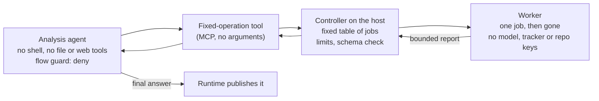

# Fixed-job runner: strict `deny` for agents that must read outside text

> 🌐 **English** · [Русский](fixed-job-runner.ru.md) · [Español](fixed-job-runner.es.md) · [Français](fixed-job-runner.fr.md) · [中文](fixed-job-runner.zh.md)

## The problem

In `"mode": "deny"` nobody is asked: after a session has read outside text, the [flow guard](flow-guard.md) refuses
opaque shell code (`npm run …`, `node -e …`, a tracker CLI that posts a comment). That is the point of the mode. But
some agents read outside text on their first step and then have to run things:

- a QA agent reads its task from a tracker, runs browser tests and reads their reports (page text);
- a digest agent reads issues and then reports through a script;
- a support agent reads a customer message and then queries a system.

Such an agent in `deny` stops on its first command. Turning `deny` down to `ask` without a person, or labelling
`npm run` as read-only, removes the protection it was meant to give. The fixed-job runner keeps `deny` and moves the
work the agent cannot do safely out of its reach.

## The pattern

| Part | Gets | Must not get |
|---|---|---|
| Analysis agent | the fixed-operation tools only; its task text | shell, file read/write, web fetch, subagents, other MCP servers |
| Tool | one request per operation to a fixed controller address | any argument from the model (no URL, command, path, flag) |
| Controller | the job table, the worker launch command, rate and concurrency limits | anything from the request except the operation name |
| Worker | the job's code and the few credentials the job itself needs (a test account) | the model key, tracker token, repository keys, Docker socket, host files |

Rules that make it hold:

1. **The agent chooses, never composes.** Tools take no arguments; each maps to one row of the controller's table.
   An unknown name or any argument is refused before anything starts.
2. **The worker is disposable and poor.** A fresh container per job: read-only root, writable only scratch volumes,
   all capabilities dropped, memory/CPU/process limits, no secrets beyond the job's own.
3. **The report is data with a schema.** The controller accepts only an exact shape (counts, names from your own code,
   first error lines with quoted strings and URL paths removed). Anything else becomes an error, never "as is". A run
   that executed nothing is a failure, not a pass.
4. **Limits live in the controller,** not in the tool: one job at a time, minimum intervals for jobs that touch
   production, a start quota per window that survives a restart.
5. **Side effects go to a separate agent.** Filing bugs, posting reports or changing records needs a tool that writes.
   Give that to a second agent that never reads the outside text the first one processed, or that runs with no keys
   beyond the one it writes with and an egress allowlist around it. The analysis agent's own final answer is published
   by the runtime.
6. **The network still matters.** The worker reaches the systems under test; put it behind an egress allowlist. The
   flow guard sees tool calls, not the network.

## Where WARDEN fits

- On the analysis agent: `"mode": "deny"`. It has nothing to leak and nothing to leak with, and the guard keeps it
  that way if the tool set ever grows.
- Instead of a custom tool, WARDEN's own [TaskAdapter](flow-guard.md) (`warden-mcp task`) can be the fixed-operation
  tool: a pinned manifest of fixed HTTP operations, a use budget and an expiry, enforced by WARDEN. For a job that takes minutes, give the operation `timeoutSeconds` (up to 3600) and add a read-only "last result" operation; with a client progress token the adapter reports progress while it waits.
- On the side-effect agent: `audit` (it must write after reading the report) plus minimal keys and the network
  allowlist; read the log with `scripts/flow-log-stats.mjs`.
- Mark the sources your integration reads in `untrustedSources` (for Multica: `examples/policies/multica.flow-policy.json`).

## Acceptance checks

1. **The runtime's launch flags do not undo the tool restrictions.** Start the agent exactly as your runtime does
   (for Claude Code under Multica: `--dangerously-skip-permissions --strict-mcp-config --mcp-config …`) and read the
   tool list it was given: only the fixed-operation tools may appear. In Claude Code, tools in `permissions.deny` are
   removed from that list even in bypass mode.
2. The controller refuses unknown jobs, any request body or query string, other peers, a second concurrent job and a
   production job inside its minimum interval.
3. The worker container has a read-only root, no capabilities, no Docker socket, and only the expected environment
   variable names.
4. A failing job and an empty job both come back as failures. A report outside the schema becomes an error.
5. A staged prompt injection in the outside text the agent reads (task, report) does not make it call anything but
   its fixed tools.

## Limits

- The report is still outside text: names and error lines can come from the system under test. Keep it short and
  stripped, and treat it as data.
- The agent's final answer is published without a tool call. What it can carry is bounded by what the report carried.
- The side-effect agent is the soft spot: keep its keys to the one it writes with.
- This narrows what a prompt-injected agent can do; it does not make the jobs themselves harmless. Review each job.
