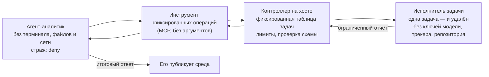

# Исполнитель фиксированных задач: строгий `deny` для агентов, которым нужно читать внешний текст

> 🌐 [English](fixed-job-runner.md) · **Русский** · [Español](fixed-job-runner.es.md) · [Français](fixed-job-runner.fr.md) · [中文](fixed-job-runner.zh.md)

## Проблема

В режиме `"mode": "deny"` никого не спрашивают: после того как сессия прочитала внешний текст, [страж потоков](flow-guard.ru.md)
отклоняет непрозрачный shell-код (`npm run …`, `node -e …`, CLI трекера, который пишет комментарий). В этом смысл
режима. Но некоторые агенты читают внешний текст на первом же шаге, а потом должны что-то запускать:

- QA-агент читает задачу из трекера, запускает браузерные тесты и читает их отчёты (текст страниц);
- агент-дайджест читает задачи и потом отчитывается через скрипт;
- агент поддержки читает сообщение клиента и потом делает запрос в систему.

Такой агент в `deny` останавливается на первой команде. Перевести `deny` в `ask` без человека или пометить
`npm run` как «только чтение» — значит убрать ту защиту, ради которой он стоял. Исполнитель фиксированных задач
оставляет `deny` и уносит из рук агента ту работу, которую он не может делать безопасно.

## Сначала: нужна ли задаче модель?

Если агенту нечего выбирать (одна фиксированная задача, запуск по расписанию или по приходу задачи), обойдитесь без
модели. Скрипт на хосте вызывает контроллер и сам публикует ограниченный отчёт, например комментарием в трекере со
своим токеном. До действия никто не читает внешний текст, так что prompt injection неоткуда взяться, и не нужно
платить модели за нажатие одной кнопки. Агента оставьте там, где у него есть настоящий выбор: какую задачу запустить
или что значит упавший отчёт.

Проверьте и то, как среда передаёт агенту задачу. Multica 0.8.2 для назначенной задачи не кладёт её текст в запрос:
она даёт номер задачи и велит прочитать её через `multica issue get`. Агент без терминала этого не может. В полевых
прогонах (qwen3-coder-next, два агента) он тратил весь запуск на поиск терминала, 139 и 50 вызовов инструментов, и так
и не запустил задачу, даже когда его собственная инструкция велела сразу вызвать инструмент. Страж выдержал, но работа
не сделана.

## Схема

| Часть | Что получает | Чего не должна получать |
|---|---|---|
| Агент-аналитик | только инструменты фиксированных операций; текст своей задачи | терминал, чтение/запись файлов, загрузку страниц, субагентов, другие MCP-серверы |
| Инструмент | один запрос на операцию к фиксированному адресу контроллера | ни одного аргумента от модели (ни адреса, ни команды, ни пути, ни флага) |
| Контроллер | таблицу задач, команду запуска исполнителя, лимиты частоты и параллельности | ничего из запроса, кроме имени операции |
| Исполнитель | код задачи и немногие учётные данные, нужные самой задаче (тестовая учётка) | ключ модели, токен трекера, ключи репозитория, Docker-сокет, файлы хоста |

Правила, на которых всё держится:

1. **Агент выбирает, но не составляет.** У инструментов нет аргументов; каждый соответствует одной строке таблицы
   контроллера. Неизвестное имя или любой аргумент — отказ до запуска.
2. **Исполнитель одноразовый и бедный.** Новый контейнер на задачу: корень только для чтения, писать можно лишь во
   временные тома, все capabilities сброшены, лимиты памяти/CPU/процессов, никаких секретов, кроме своих.
3. **Отчёт — данные со схемой.** Контроллер принимает только точную форму (счётчики, имена из вашего кода, первые
   строки ошибок без строк в кавычках и путей адресов). Всё остальное — ошибка, а не «как есть». Прогон, который
   ничего не выполнил, — провал, а не успех.
4. **Лимиты — в контроллере,** а не в инструменте: одна задача за раз, минимальные интервалы для задач на prod, квота
   запусков за окно, которая переживает перезапуск.
5. **Побочные действия — у отдельного агента.** Завести баг, опубликовать отчёт, изменить запись — для этого нужен
   пишущий инструмент. Отдайте его второму агенту, который не читает внешний текст первого, или который работает
   без ключей, кроме того, которым пишет, и за белым списком адресов. Итоговый ответ агента-аналитика публикует среда.
6. **Сеть по-прежнему важна.** Исполнитель ходит в проверяемые системы; поставьте его за белый список адресов.
   Страж видит вызовы инструментов, а не сеть.

## Где здесь WARDEN

- На агенте-аналитике: `"mode": "deny"`. Утечь у него нечему и нечем, а страж держит это так, если набор инструментов
  когда-нибудь вырастет.
- Вместо собственного инструмента можно взять встроенный [TaskAdapter](flow-guard.ru.md) WARDEN (`warden-mcp task`):
  закреплённый манифест фиксированных HTTP-операций, бюджет использований и срок действия, которые проверяет WARDEN. Для задачи на минуты задайте операции `timeoutSeconds` (до 3600) и добавьте операцию «последний результат» только на чтение; с клиентским progress token адаптер сообщает прогресс, пока ждёт.
- На агенте побочных действий: `audit` (он должен писать после чтения отчёта) плюс минимум ключей и белый список
  адресов; журнал смотрите скриптом `scripts/flow-log-stats.mjs`.
- Источники, которые читает ваша интеграция, разметьте в `untrustedSources` (для Multica:
  `examples/policies/multica.flow-policy.json`).

## Проверки при приёмке

1. **Флаги запуска среды не отменяют ограничения инструментов.** Запустите агента ровно так, как его запускает среда,
   и посмотрите выданный ему список инструментов: в нём могут быть только инструменты фиксированных операций (и
   `ToolSearch`, который их подгружает). Claude Code под Multica 0.8.2 получает `--permission-mode bypassPermissions
   --disallowedTools AskUserQuestion`, а `--strict-mcp-config --mcp-config …` — только если у агента есть свой
   MCP-конфиг. Если инструмент подключён через управляемый `managed-mcp.json`, оставьте MCP-конфиг агента пустым:
   Claude Code отказывается запускаться с `--strict-mcp-config` рядом с корпоративным MCP-конфигом. В Claude Code
   инструменты из `permissions.deny` убираются из этого списка даже в режиме без подтверждений. Запрещайте каждый
   инструмент по имени, а не только терминал и файлы: свежие версии дают ещё `Skill`, `Workflow`, `SendMessage`,
   `ListAgents`, `TaskStop`, `ScheduleWakeup`, инструменты `Cron…` и рабочих деревьев. Перечитывайте список после
   каждого обновления Claude Code.
2. Контроллер отклоняет неизвестные задачи, любое тело запроса и строку запроса, чужие адреса, вторую параллельную
   задачу и задачу на prod внутри её минимального интервала.
3. У контейнера исполнителя корень только для чтения, нет capabilities, нет Docker-сокета, и в окружении только
   ожидаемые имена переменных.
4. Упавшая задача и пустая задача обе возвращаются как провал. Отчёт вне схемы становится ошибкой.
5. Подставная prompt injection во внешнем тексте, который читает агент (задача, отчёт), не заставляет его вызывать
   ничего, кроме своих фиксированных инструментов.

## Ограничения

- Отчёт всё равно внешний текст: имена и строки ошибок могут прийти из проверяемой системы. Держите его коротким и
  вычищенным и считайте данными.
- Итоговый ответ агента публикуется без вызова инструмента. Что он может унести — ограничено тем, что было в отчёте.
- Слабое место — агент побочных действий: оставляйте ему только тот ключ, которым он пишет.
- Схема сужает то, что может сделать агент под prompt injection; она не делает безвредными сами задачи. Проверяйте
  каждую задачу.
