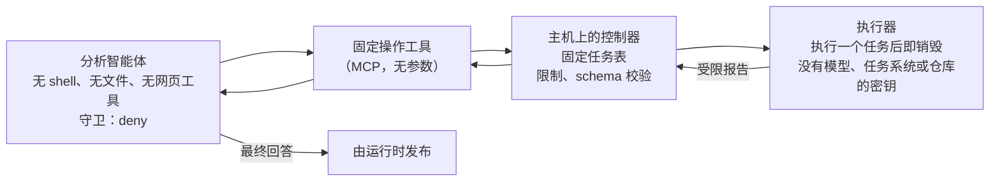

# 固定任务执行器：让必须读取外部文本的智能体在严格 `deny` 下工作

> 🌐 [English](fixed-job-runner.md) · [Русский](fixed-job-runner.ru.md) · [Español](fixed-job-runner.es.md) · [Français](fixed-job-runner.fr.md) · **中文**

## 问题

在 `"mode": "deny"` 下不会询问任何人：会话读到外部文本后，[流守卫](flow-guard.zh.md)会拒绝不透明的 shell 代码
（`npm run …`、`node -e …`、会发评论的任务系统 CLI）。这正是该模式的意义。但有些智能体第一步就要读外部文本，
随后还必须执行操作：

- QA 智能体从任务系统读取任务，运行浏览器测试并读取测试报告（页面文本）；
- 摘要智能体读取 issue，然后通过脚本汇报；
- 客服智能体读取客户消息，然后查询某个系统。

这样的智能体在 `deny` 下执行第一条命令就会停住。把 `deny` 降为无人应答的 `ask`，或把 `npm run` 标为只读，
都会拿掉它本该提供的保护。固定任务执行器保留 `deny`，把智能体无法安全完成的工作移出它的能力范围。

## 首先：这个任务需要模型吗？

如果智能体没有什么可选择的（一个固定任务，按计划或在任务到达时启动），就不要用模型。由主机上的脚本调用控制器，并自行发布受限报告，例如用它自己的令牌在任务系统中发表评论。行动之前没有任何东西读取外部文本，提示注入无从进入，也不必为按一个按钮付费给模型。只在智能体有真正选择的地方保留它：运行哪个任务，或者失败的报告意味着什么。

还要检查运行时如何把任务交给智能体。Multica 0.8.2 对已分配的 issue 不会把任务文本放进提示词：它只给出 issue 编号，并要求智能体用 `multica issue get` 读取。没有 shell 的智能体做不到。在实地运行中（qwen3-coder-next，两个智能体），它把整次运行都花在寻找 shell 上，分别调用工具 139 次和 50 次，始终没有启动任务，即使它自己的指令要求立即调用该工具。守卫守住了，但工作没有完成。

## 方案

| 部分 | 获得 | 不得获得 |
|---|---|---|
| 分析智能体 | 只有固定操作工具；自己的任务文本 | shell、文件读写、网页获取、子智能体、其他 MCP 服务器 |
| 工具 | 每个操作向固定的控制器地址发一个请求 | 来自模型的任何参数（URL、命令、路径、开关都不行） |
| 控制器 | 任务表、启动执行器的命令、频率与并发限制 | 请求中除操作名以外的任何内容 |
| 执行器 | 任务代码和任务本身需要的少量凭据（测试账号） | 模型密钥、任务系统令牌、仓库密钥、Docker 套接字、主机文件 |

保证方案成立的规则：

1. **智能体只选择，不拼装。** 工具没有参数；每个工具对应控制器任务表中的一行。未知名称或任何参数在启动前即被拒绝。
2. **执行器是一次性的、一无所有的。** 每个任务一个新容器：根文件系统只读，只能写入临时卷，去掉全部 capabilities，
   限制内存/CPU/进程，除自身所需外没有任何秘密。
3. **报告是带 schema 的数据。** 控制器只接受精确的结构（计数、来自你自己代码的名称、去掉引号内字符串和 URL 路径的
   首行错误）。其余一律视为错误，绝不“原样”转交。什么都没执行的运行算失败，而不是成功。
4. **限制放在控制器里，** 而不是工具里：同一时间只运行一个任务；涉及生产环境的任务有最小间隔；每个时间窗口的
   启动配额在重启后依然有效。
5. **副作用交给另一个智能体。** 提交 bug、发布报告或修改记录需要可写的工具。把它交给第二个智能体：它不读取第一个
   智能体处理过的外部文本，或者除用于写入的那个密钥外没有其他密钥，并处于出口白名单之后。分析智能体的最终回答由
   运行时发布。
6. **网络依然重要。** 执行器要访问被测系统；请把它放在出口白名单之后。守卫看到的是工具调用，而不是网络。

## WARDEN 的位置

- 分析智能体上：`"mode": "deny"`。它既没有可泄露的东西，也没有泄露的手段；若将来工具集扩大，守卫会保持这一点。
- 不必自己写工具，也可以用 WARDEN 自带的 [TaskAdapter](flow-guard.zh.md)（`warden-mcp task`）作为固定操作工具：
  固定的 HTTP 操作清单（已锁定）、使用次数预算和有效期，均由 WARDEN 强制执行。对于需要数分钟的任务，请为操作设置 `timeoutSeconds`（最多 3600），并增加一个只读的“最后结果”操作；若客户端提供 progress token，适配器在等待期间会报告进度。
- 副作用智能体上：`audit`（它读完报告后必须写入），加上最少的密钥和出口白名单；用 `scripts/flow-log-stats.mjs`
  查看日志。
- 在 `untrustedSources` 中标记你的集成会读取的来源（Multica：`examples/policies/multica.flow-policy.json`）。

## 验收检查

1. **运行时的启动参数不会抵消工具限制。** 完全按运行时的方式启动智能体，查看它获得的工具列表：其中只能有固定操作工具（以及加载它们的 `ToolSearch`）。Multica 0.8.2 下的 Claude Code 获得 `--permission-mode bypassPermissions --disallowedTools AskUserQuestion`，只有当智能体有自己的 MCP 配置时才会加上 `--strict-mcp-config --mcp-config …`。如果工具来自托管的 `managed-mcp.json`，请让智能体的 MCP 配置保持为空：存在企业 MCP 配置时，Claude Code 拒绝 `--strict-mcp-config`。在 Claude Code 中，即使在 bypass 模式下，`permissions.deny` 中的工具也会从该列表中移除。按名称禁止每一个工具，而不只是 shell 和文件：新版本还会提供 `Skill`、`Workflow`、`SendMessage`、`ListAgents`、`TaskStop`、`ScheduleWakeup` 以及 `Cron…` 和 worktree 工具。每次升级 Claude Code 后都要重新查看该列表。
2. 控制器拒绝未知任务、任何请求体或查询字符串、其他来源地址、第二个并发任务，以及处于最小间隔内的生产环境任务。
3. 执行器容器的根文件系统只读，没有 capabilities，没有 Docker 套接字，环境变量中只有预期的名称。
4. 失败的任务和空任务都以失败返回。不符合 schema 的报告变为错误。
5. 在智能体读取的外部文本（任务、报告）中植入的提示注入，不会让它调用固定工具以外的任何东西。

## 局限

- 报告仍是外部文本：名称和错误行可能来自被测系统。保持简短、清理干净，并把它当作数据。
- 智能体的最终回答发布时不经过工具调用。它能带走的内容以报告中的内容为限。
- 薄弱环节是副作用智能体：只给它用于写入的那一个密钥。
- 这缩小了被提示注入的智能体能做的事；它并不会让任务本身变得无害。请逐一审查每个任务。
